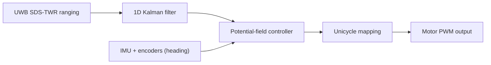

# UWB Swarm Formation Control

Infrastructure-free formation control for low-cost robot swarms using Ultra-Wideband (UWB) ranging instead of cameras, markers, motion capture, or GPS. Each follower tracks its distance to both the global leader and its immediate predecessor, which damps oscillations along the robot chain and keeps the cost per robot low enough for student groups to build a swarm.

> CO3060 Computer Systems Design Project, E22 Group 20, Department of Computer Engineering, Faculty of Engineering, University of Peradeniya.

## Motivation

Coordinated multi-robot formations are useful in warehouse logistics, precision agriculture, environmental monitoring, and search-and-rescue. Most existing demonstrations depend on motion-capture systems (Vicon, OptiTrack) or GPS, which are expensive, limited to controlled spaces, or unavailable indoors. This project asks whether a swarm of cheap robots can measure their own relative positions and hold a commanded formation in an ordinary indoor space, with no external infrastructure.

## How It Works

- **Ranging:** Robots measure inter-robot distances with Symmetric Double-Sided Two-Way Ranging (SDS-TWR) over a UWB radio. SDS-TWR cancels clock drift, so the robots don't need synchronized clocks.
- **Dual-distance topology:** Each follower `R_i` holds two distance constraints, one to the leader `R_0` and one to its predecessor `R_(i-1)`. A plain leader-follower chain suffers from string instability. Adding the leader link is intended to damp that.
- **Scheduling:** A 50 ms TDMA frame gives each robot a 10 ms ranging slot, so the whole swarm refreshes at 20 Hz.
- **Filtering:** Raw ranges (typically 5 to 15 cm of noise plus multipath spikes) go through a 1D Extended Kalman Filter.
- **Control:** A potential-field controller combines the filtered distances with a heading estimate from the IMU and wheel encoders. It outputs linear and angular velocity commands for a differential-drive (unicycle) robot.
- **Decentralized:** Every follower computes its own steering, so the swarm keeps running if the base station goes offline. Only the desired formation distances are set globally.
- **Telemetry:** The leader relays periodic summaries over ESP-NOW to a base-station laptop, which logs distances, control errors, and battery voltage to CSV for analysis.

## Hardware (per robot)

All nodes use the same bill of materials, so any unit can act as the leader or a follower.

| Function | Component |
|---|---|
| Microcontroller | ESP32 NodeMCU (30-pin) |
| UWB ranging | Decawave/Qorvo DWM1000 or DWM3000 module (SPI) |
| Heading | MPU6050 6-DoF IMU + magnetic wheel encoders |
| Drive | 2 x N20 6 V gear motors with encoders, MX1508 dual motor driver |
| Chassis | 2-wheel round double-deck smart car chassis, 65 mm wheels |
| Power | 3S 18650 pack, 3S BMS, LM2596 buck (6 V motor rail), Mini-360 buck (5 V logic rail) |
| Level shifting | 4-channel 3.3 V to 5 V logic level converter |

## Roadmap

- [ ] Finalize the UWB module choice and schematic
- [ ] Single-link SDS-TWR ranging between two modules
- [ ] Antenna delay calibration procedure
- [ ] Kalman filter and TDMA scheduling
- [ ] Potential-field controller and unicycle mapping
- [ ] Leader plus two-follower formation demo
- [ ] ESP-NOW telemetry and base-station logging
- [ ] Tuning and evaluation of formation error

## Security

ESP-NOW broadcasts are unauthenticated by default. Each robot keeps a whitelist of paired MAC addresses and discards packets that arrive outside the expected TDMA slot. The system collects no personal data, only robot telemetry (distances, headings, battery levels).

## Team

E22 Group 20: E/22/044 - Nithika Bandara, E/22/135 - Thimira Dilshan, E/22/353 - Gayasha Sandeepa, E/22/421 - Tharindu Weerasinghe

## License

The theme is available as open source under the terms of the MIT License.
